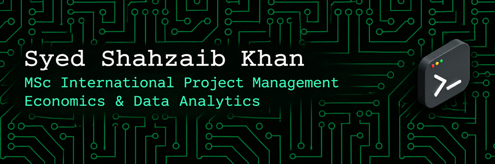

## Hi, I’m Shahzaib Khan 👋

I hold an MSc in International Project Management from York St John University and have a background in economics and training in data science. I’m interested in using data to understand business problems and support better decisions.

I use Python, MySQL, and Power BI to clean and explore datasets, build visualisations, and communicate findings. My projects and training have included customer behaviour analysis, sentiment analysis, and predictive modelling.

### Tools I use

